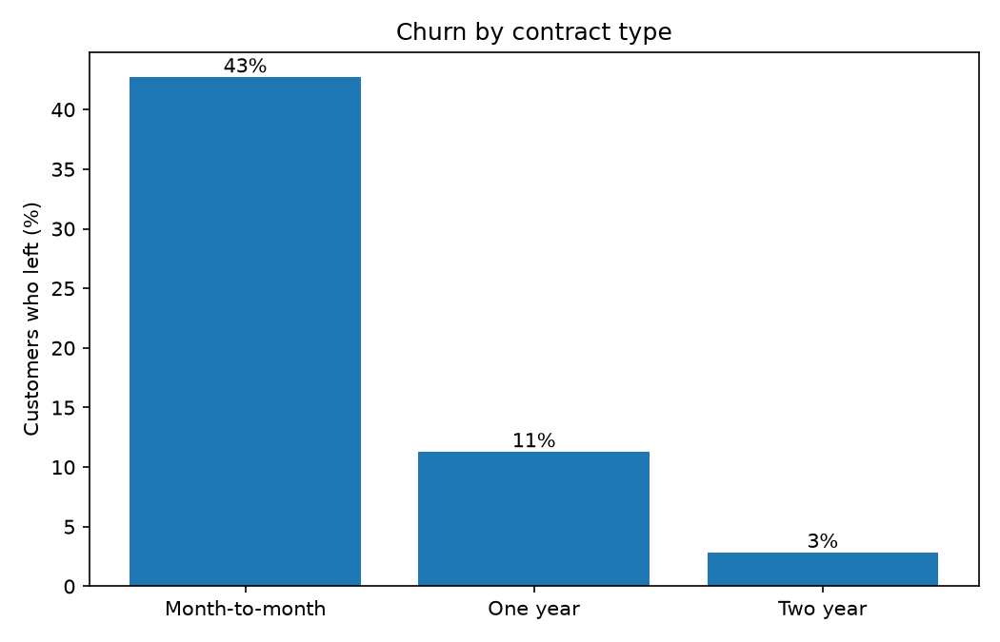
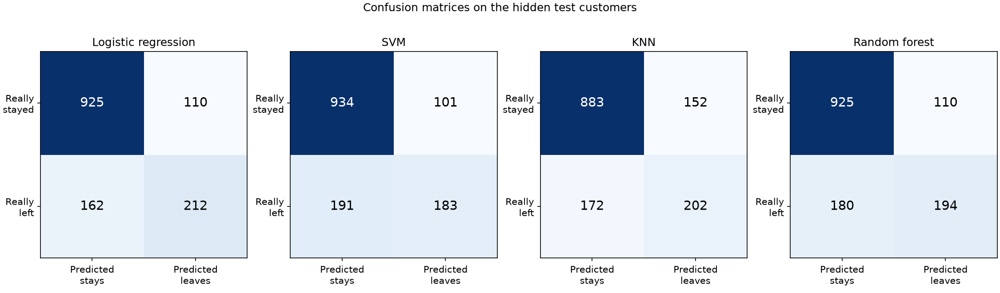
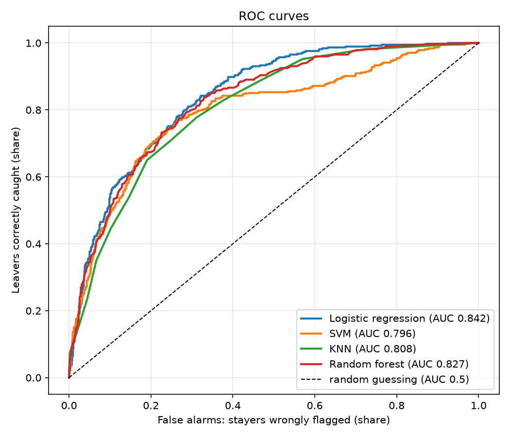
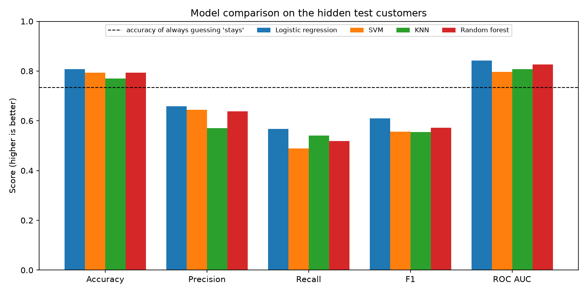

# Customer Churn Prediction: Comparing Four Classifiers

Predicting which telecom customers will leave, using four machine-learning models (logistic regression, SVM, KNN, and random forest) and comparing them fairly on the same data, the same split, and the same metrics.

"Churn" means a customer leaving the company. Catching likely leavers early lets a business offer them a reason to stay.

## Dataset

The [Telco Customer Churn](https://www.kaggle.com/datasets/blastchar/telco-customer-churn) dataset (IBM sample data, available on Kaggle): 7,043 customers and 21 columns, covering account details (tenure, contract type, payment method, monthly and total charges), services used (phone, internet, streaming, tech support), and whether the customer left.

1,869 of the 7,043 customers left, which is 26.5%.

## What the script does

Everything runs from `churn_models.py`:

1. **Cleaning**
   - `TotalCharges` is stored as text and is blank for 11 brand-new customers; it is converted to a number, with blanks set to 0 because those customers haven't paid anything yet.
   - `customerID` is dropped, since an ID can't predict anything.
2. **Encoding**: text columns are turned into 0/1 columns with one-hot encoding.
3. **Train/test split**: 80% for training and 20% held back as a final test, stratified so both parts keep the same 26.5% churn rate.
4. **Scaling**: logistic regression, SVM, and KNN are wrapped in a pipeline with `StandardScaler`, so every column is on the same scale. Random forest doesn't need scaling.
5. **Evaluation**: each model gets 5-fold cross-validation on the training data, then is trained on all of it and scored once on the held-back test customers.

| Model | Settings |
|---|---|
| Logistic regression | `max_iter=1000` |
| SVM | Default RBF kernel |
| KNN | 15 neighbours |
| Random forest | 300 trees |

## Results

Scores on the 1,409 held-back test customers:

| Model | Accuracy | Precision | Recall | F1 | ROC AUC | CV AUC (± spread) |
|---|---|---|---|---|---|---|
| **Logistic regression** | **0.807** | **0.658** | **0.567** | **0.609** | **0.842** | **0.846 ± 0.014** |
| SVM | 0.793 | 0.644 | 0.489 | 0.556 | 0.796 | 0.806 ± 0.014 |
| KNN | 0.770 | 0.571 | 0.537 | 0.554 | 0.808 | 0.821 ± 0.010 |
| Random forest | 0.794 | 0.638 | 0.519 | 0.572 | 0.827 | 0.824 ± 0.013 |

**Baseline:** a "model" that always guesses "stays" would be right 73.5% of the time, so accuracy alone says little here.

Of the 374 test customers who really left:

| Model | Leavers caught | Leavers missed | Stayers wrongly flagged |
|---|---|---|---|
| Logistic regression | 212 | 162 | 110 |
| SVM | 183 | 191 | 101 |
| KNN | 201 | 173 | 151 |
| Random forest | 194 | 180 | 110 |

### What the results show

- **Logistic regression is the best model on every metric**, and its cross-validation AUC (0.846) agrees closely with its test AUC (0.842), so the result is not a lucky split.
- **The simplest model wins.** Random forest, the most complex model, doesn't beat logistic regression. That suggests the relationship between these features and churn is close to linear.
- **Every model misses many leavers.** Even the best one catches only 57% of them (recall 0.567). Because only about a quarter of customers leave, the models lean towards predicting "stays".
- **Contract type matters most at a glance.** Before any model, churn is 42.7% for month-to-month customers, 11.3% on one-year contracts, and 2.8% on two-year contracts.

## Plots

Running the script saves four images next to it.

**Churn by contract type**



**Confusion matrices**



Right and wrong predictions on the test customers for each model.

**ROC curves**



How well each model ranks leavers above stayers, across every possible decision threshold. The dashed diagonal is random guessing.

**Model comparison**



All five test metrics side by side, with the always-guess-"stays" accuracy as a dashed line.

## How to run

You need Python 3 with pandas, scikit-learn, and Matplotlib.

```bash
pip install pandas scikit-learn matplotlib
```

1. Download the dataset from [Kaggle](https://www.kaggle.com/datasets/blastchar/telco-customer-churn).
2. The downloaded file is called `WA_Fn-UseC_-Telco-Customer-Churn.csv`. Rename it to `Telco-Customer-Churn.csv`, which is the name the script expects, and put it in the same folder as `churn_models.py`.
3. Run:

   ```bash
   python churn_models.py
   ```

The script prints the results table, saves `results_table.csv` and the four images, and opens the plots in a window.

## Project structure

```
.
├── churn_models.py              # the full analysis
├── Telco-Customer-Churn.csv     # dataset (downloaded from Kaggle)
├── results_table.csv            # created when the script runs
├── 1_churn_by_contract.png      # created when the script runs
├── 2_confusion_matrices.png
├── 3_roc_curves.png
├── 4_model_comparison.png
└── README.md
```

## Possible improvements

- Handle the class imbalance, for example with `class_weight="balanced"` or a lower decision threshold, to catch more leavers
- Tune each model's settings with a grid search instead of using fixed values
- Add gradient boosting models such as XGBoost or LightGBM
- Show which features drive churn, using logistic regression coefficients or random forest feature importance
- Weigh the business cost of a missed leaver against a wrongly flagged stayer when choosing the threshold

## Author

Payal Satapathy
